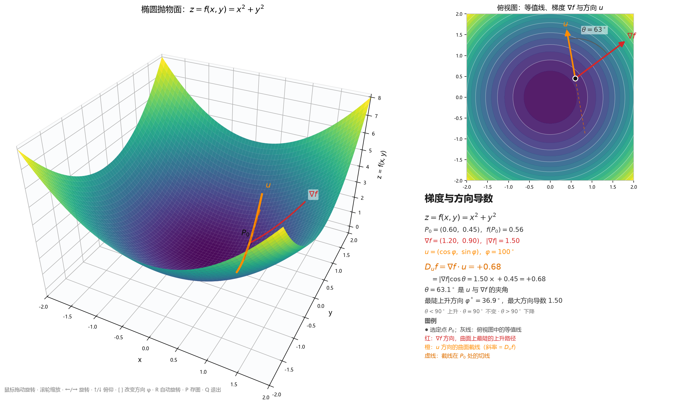

# 二元函数的梯度与方向导数 · 3D 可旋转演示

一个 Python + Matplotlib 的小程序：给定二元函数 `f(x, y)`，在曲面上选一个点 `P0`、
选一个单位方向 `u`，把 **梯度 ∇f**、**方向导数 D_u f** 和它们的几何关系画成可鼠标拖动旋转的 3D 图。



## 快速开始

```bash
# 依赖（Anaconda 一般已自带 numpy/matplotlib，GIF 另需 Pillow）
pip install numpy matplotlib pillow

# 打开交互窗口
python gradient_directional.py

# 换一个预设曲面 / 换点 / 换方向（角度单位：度）
python gradient_directional.py --preset saddle
python gradient_directional.py --point 0.8 0.5 --angle 45

# 不弹窗，直接出图
python gradient_directional.py --save my.png --no-show
python gradient_directional.py --gif my.gif --no-show
```

默认算例：`f(x, y) = x² + y²`，`P0 = (0.60, 0.45)`，`φ = 100°`。

## 交互方式

| 操作 | 作用 |
| --- | --- |
| 鼠标左键拖动 | 3D 旋转（Matplotlib 自带） |
| 滚轮 | 缩放 |
| `←` / `→` | 绕竖直轴旋转 |
| `↑` / `↓` | 改变俯仰角 |
| `[` / `]` | 改变方向角 φ（每次 10°），图上所有量实时重算 |
| `R` | 自动旋转开 / 关 |
| `P` | 把当前画面存成 `demo_snapshot.png` |
| `Q` / `Esc` | 退出 |

## 数学原理

设 `f` 在 `P0 = (x0, y0)` 处可微。

**梯度**

```
∇f(P0) = ( ∂f/∂x , ∂f/∂y )|_{P0}
```

它指向函数值上升最快的方向，模长 `|∇f|` 就是所有方向导数中的最大值。

**方向导数** 沿单位向量 `u = (cosφ, sinφ)`：

```
D_u f(P0) = lim_{t→0} [f(P0 + t u) − f(P0)] / t
          = ∇f(P0) · u
          = |∇f| cosθ
```

其中 `θ` 是 `u` 与 `∇f` 的夹角。于是：

- `θ = 0°`：沿梯度方向，`D_u f = |∇f|`（最大）；
- `θ = 90°`：沿等值线方向，`D_u f = 0`；
- `θ > 90°`：函数值下降，`D_u f < 0`。

**手算核对**（默认算例）：

```
f(0.6, 0.45) = 0.6² + 0.45² = 0.5625
∇f = (2x, 2y) = (1.20, 0.90),   |∇f| = 1.500
u  = (cos100°, sin100°) = (−0.1736, 0.9848)
D_u f = 1.20×(−0.1736) + 0.90×0.9848 = 0.678
cosθ  = 0.678 / 1.500 = 0.452  →  θ ≈ 63.1°
最陡上升方向 φ* = atan2(0.90, 1.20) ≈ 36.9°
```

程序在终端也会打印同样的数值，方便对照。

## 图上的元素

- **曲面**：`z = f(x, y)`，颜色表示高度；
- **黑点 + 竖虚线**：选定点 `P0` 及其在 `xy` 平面上的投影；
- **红色曲线**：沿 `∇f` 方向的最陡上升路径；
- **橙色粗线**：曲面沿 `u` 方向的截线 `f(P0 + t u)`，它在 `P0` 处的切线斜率就是 `D_u f`；
- **橙色虚线**：该截线在 `P0` 处的切线（凸曲面上它位于曲面下方，可能被挡住，转一下视角或换马鞍面预设就能看到）；
- **右上俯视图**：等值线、`∇f`、`u`、夹角 `θ`——这里没有透视遮挡，方向关系最清楚；
- **右下文字面板**：`∇f`、`u`、`D_u f`、`cosθ` 分解、最陡方向等全部数值。

## 换函数

打开 `gradient_directional.py`，顶部有 `PRESETS` 字典，一项就是一个曲面：

```python
"bowl": Surface(
    name="椭圆抛物面",
    f=lambda x, y: x * x + y * y,          # 函数
    grad=lambda x, y: (2.0 * x, 2.0 * y),  # 解析梯度，和 f 对应
    latex=r"$z=f(x,y)=x^{2}+y^{2}$",
    xlim=(-2.0, 2.0), ylim=(-2.0, 2.0),
    default_point=(0.6, 0.45),
    default_angle=100.0,
    elev=34.0, azim=-63.0,                 # 初始视角
),
```

没有解析梯度也不要紧，用内置的中心差分：

```python
f = lambda x, y: 1.0 / (1.0 + x * x + y * y)
my = Surface(
    name="我的曲面", f=f, grad=lambda x, y: numeric_gradient(f, x, y),
    latex=r"$z=1/(1+x^2+y^2)$",
    xlim=(-2, 2), ylim=(-2, 2),
    default_point=(0.4, -0.3), default_angle=30.0,
)
PRESETS["mine"] = my
```

然后 `python gradient_directional.py --preset mine`。

内置三个预设：

| 预设 | 函数 | 特点 |
| --- | --- | --- |
| `bowl`（默认） | `x² + y²` | 最简单的碗形，梯度背离谷底 |
| `saddle` | `x² − y²` | 马鞍面，能同时看到上升/下降方向，切线在曲面上方可见 |
| `hill` | `3e^{-(x²+y²)/2} + 0.2x` | 高斯小山，凹曲面，适合看切线“悬”在曲面上方 |

## 文件

| 文件 | 说明 |
| --- | --- |
| `gradient_directional.py` | 主程序（交互 + 出图） |
| `demo_static.png` | 默认算例的高清静态图 |
| `demo_rotation.gif` | 摆动旋转的 GIF（40 帧，900 px 宽） |
| `demo_saddle.png` / `demo_hill.png` | 另外两个预设的静态图 |

## 常见问题

- **中文变方框**：脚本会自动在 `Microsoft YaHei / SimHei / PingFang SC / Noto Sans CJK` 里挑一个已安装的字体；若都没有，装一个中文字体即可。
- **`--no-show` 仍弹窗**：脚本在 `--no-show` 时会切到 `Agg` 后端；如果手动改过 Matplotlib 配置，可先设环境变量 `MPLBACKEND=Agg`。
- **GIF 报错缺 Pillow**：`pip install pillow`。
- **想看切线但被曲面挡住**：凸曲面（碗形）的切平面在曲面下方，被挡住是正常的；用鼠标把视角转到侧面/下方，或换 `saddle` 预设。
